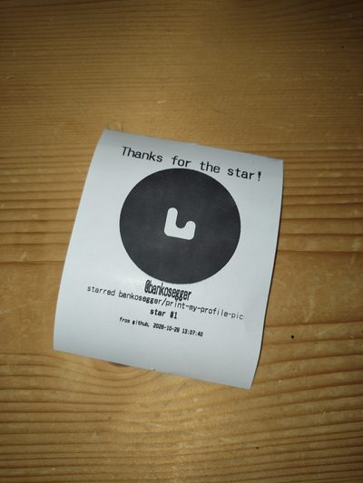

# print-my-profile-pic

Star this repo to have your GitHub profile picture framed and printed out on my receipt printer.

That's it!

  

## How's it work?

GitHub allows you to create webhooks for specific events on your repos, and I've set one up for [starring](https://docs.github.com/en/webhooks/webhook-events-and-payloads#star) this project.

When that happens, a payload is POSTed to a [Cloudflare Tunnel](https://developers.cloudflare.com/tunnel/) domain, which leads to a small Python (Flask) app running in Docker next to my printer. The app checks the webhook's signature, so only GitHub can make it print.

From the inbound request, you can glean info about the person who starred the repo, like their username and avatar URL. The app downloads their profile picture, places it behind the cut-out of a random photo frame from [`frames/`](frames), and adds their username, the repo name and the star count. Then it dithers the whole thing to black and white for the thermal head.

The printer is an SII RP-D10 thermal receipt printer, connected via USB. The app uses [python-escpos](https://github.com/python-escpos/python-escpos) to format the receipt and send it off.

Everyone gets one print: unstarring and starring again won't print a second copy.

## But why?

I saw [aschmelyun's original](https://github.com/aschmelyun/print-my-profile-pic) and it looked like fun. That's pretty much it!

## What now?

Want to add a new frame? Send in a PR! Any PNG with a transparent cut-out in the middle works. Name it `frame-<n>.png`.

## Credits

This is a fork of [aschmelyun/print-my-profile-pic](https://github.com/aschmelyun/print-my-profile-pic). The idea and the original frames are his. His version runs a PHP script on a Raspberry Pi with [escpos-php](https://github.com/mike42/escpos-php) and an Epson TM-T88IV.
